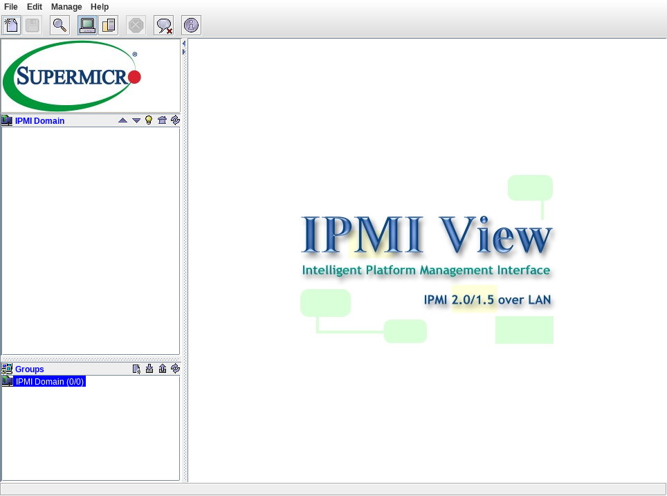

# IPMIView_2.9

Supermicro IPMIView 2.9.32 (build 140624), bản Linux x64 có kèm JRE.

Được chuyển từ bản Windows 2.9: dùng nguyên các file `.jar` và `.so` của 2.9, JRE Linux (Java 1.7.0_79) và script khởi động thay cho các file `.exe`.

## Chạy

```bash
git clone https://github.com/tungsilva/IPMIView_2.9.git
cd IPMIView_2.9
chmod +x IPMIView20 iKVM JViewerX9 TrapReceiver jre/bin/*
./IPMIView20
```

Các công cụ khác: `./iKVM`, `./JViewerX9`, `./TrapReceiver`.


